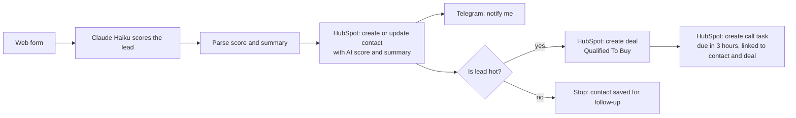

# n8n Lead Qualifier: AI-scored property enquiries into HubSpot

A real estate enquiry comes in through a web form. Claude reads it and scores the lead hot, warm or cold against criteria I wrote from nearly two years as a sales associate at Ray White Southbank. Every lead lands in HubSpot with its score, and I get a Telegram message straight away. Hot leads also get a deal in the pipeline and a call task due within 3 hours, assigned to the agent.

The problem it solves: in a busy sales team, enquiries arrive unsorted and the best ones wait in the same queue as the casual browsers. This puts the ready-to-buy leads in front of the agent within minutes.

## How it works

| Lead | Example | What happens |
|---|---|---|
| Hot | Pre-approved, $700k budget, clear requirements, buying within a month | Contact, deal, call task, Telegram |
| Seller | Wants an appraisal | Treated as hot, summary starts with "Seller:" |
| Warm | Real intent, no finance yet, buying next year | Contact with score, Telegram |
| Cold | Just curious about prices | Contact with score, Telegram |

**Stack:** n8n Cloud, Anthropic API (Claude Haiku), HubSpot free CRM (OAuth), Telegram Bot API.

## Decisions and why

**Claude scores, using my criteria.** A hot buyer needs all four: a stated budget, pre-approval or cash, clear requirements, and a plan to buy within 3 months. Sellers and appraisal requests are always hot, because in real estate a listing is worth more than a single buyer. Writing these rules was the part that came from my sales experience, not from the tools.

**The score is saved on the contact, not only sent to my phone.** Two custom properties, AI lead score (dropdown) and AI lead summary, are filled for every lead. I deliberately did not use HubSpot's built-in Lead Status: that field tracks what the salesperson has done (attempted to contact, connected), so the first call would overwrite the score.

**The task is created through HubSpot's API, not n8n's HubSpot node.** n8n's HubSpot node cannot assign a task's owner, a known issue other users have reported. I replaced it with an HTTP Request node calling HubSpot's v3 tasks endpoint directly, using the same OAuth credential.

**The task links to the deal as well as the contact.** Buyers often inspect several properties across colleagues' listings. A task linked only to a person doesn't say which property the call is about.

**The credential can only talk to HubSpot.** An HTTP Request node sends its credential to whatever URL is typed in it. The HubSpot credential is locked to `api.hubapi.com`, so a mistyped or malicious URL cannot receive it.

**Claude only sees the name and the enquiry.** Email and phone number go to HubSpot but are never sent to the AI model, because scoring doesn't need them.

## A bug worth mentioning

During the final test, a warm lead arrived on Telegram with an empty score. The run had looked successful, because an empty score simply fails the "is hot" check. The cause: Claude's reply sometimes starts with a thinking block, so the answer is not always the first item in the response. The parser read a fixed position (`content[0]`). I changed it to find the block whose type is `text`, wherever it sits. Without the fix, hot leads would have silently missed their deal and call task.

## What happens when a step fails

- **Claude replies with something that isn't valid JSON, or the API is down:** the parse step errors and the run stops before HubSpot. The enquiry is kept in n8n's execution log but nobody is notified. This is the biggest gap (see "What I'd add next").
- **HubSpot fails:** same, the run stops and no notification is sent.
- **Telegram fails:** the contact, deal and task are still created, because the notification runs on its own branch.

## Where the scoring can be wrong

- Enquiries that mix buying and selling ("we'll sell ours to buy a bigger place") are scored as sellers, which is usually right but not always.
- "Cash" or "finance sorted" can be stated loosely. The model takes the enquiry at face value.
- Rental enquiries and anything off-topic score cold, by design.
- Scores can vary slightly between runs on borderline enquiries. The summary is there so a person can judge quickly.

## Data passing through each tool

| Tool | Receives |
|---|---|
| n8n form | Name, email, phone, enquiry |
| Anthropic (Claude) | Name and enquiry only |
| HubSpot | Name, email, phone, AI score, AI summary |
| Telegram | Name, score, summary |

All testing used fake data: example.com email addresses and phone numbers from ACMA's reserved fictional range.

## Known limitations and what I'd add next

- **Error alert:** an n8n error workflow that sends a Telegram message when any step fails, so no enquiry is lost silently.
- **Round-robin assignment:** every lead currently goes to one owner. A team would rotate leads between agents.
- **Seller pipeline:** seller leads currently land in the buyer pipeline and are named "purchase". They should get their own pipeline.
- **Call cadence:** five call attempts across mornings, evenings and weekends, then mark the lead unresponsive.
- **Duplicate deals:** contacts are matched by email, but deals are not, so a repeat hot enquiry creates a second deal.

## Importing the workflow

1. In n8n: Workflows, Import from file, choose `lead-qualifier.json`.
2. Create three credentials: Anthropic API, HubSpot OAuth2 (set Allowed HTTP Request Domains to `api.hubapi.com`), Telegram API.
3. In HubSpot, create two contact properties: `ai_lead_score` (dropdown: hot, warm, cold) and `ai_lead_summary` (multi-line text).
4. Replace `YOUR_HUBSPOT_OWNER_ID` (contact and deal nodes) and `YOUR_TELEGRAM_CHAT_ID` (Telegram node).
5. Run a test lead, then publish.

## How I built it

I built the workflow by hand in n8n, without n8n's AI builder, using Claude as a tutor for expression syntax and API details. The scoring criteria and all testing are mine. I made the design decisions above with Claude's input, and I can explain each one.
